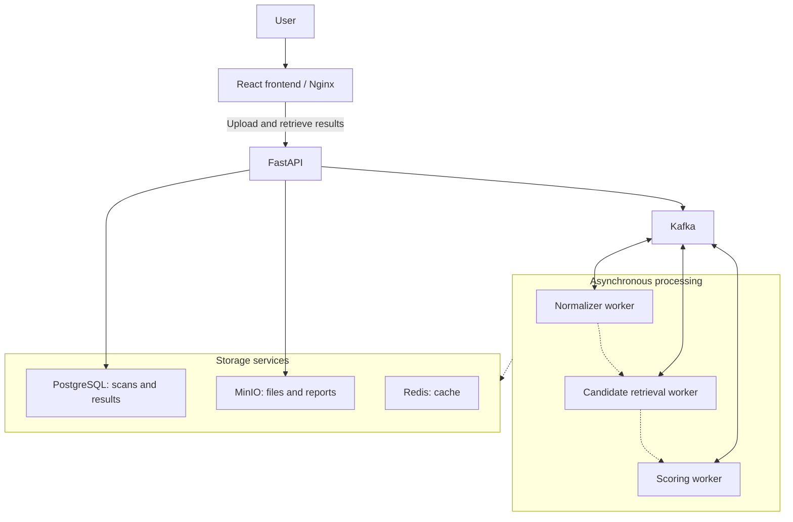

<h1 align="center">PlagCode</h1>

<p align="center">
  <b>Code similarity analysis: token-based comparison with a Jaccard baseline</b><br/>
  Event-driven pipeline · React · FastAPI · Kafka · PostgreSQL · Docker Compose
</p>

<p align="center">
  
  
  
  
  
  
  
</p>

PlagCode compares source files and presents their overlap as scores, tables and visualizations. The current engine is **lexical**: it measures how many distinct tokens two files share. Structural and semantic methods, together with a reproducible evaluation, are the next milestones (see [Roadmap](#roadmap)).

> [!IMPORTANT]
> A similarity score is a signal for **human review**. It is neither proof of plagiarism nor the probability that plagiarism occurred.

<!-- Add a 30-second demo here once recorded: upload → scan → heatmap → side-by-side view.
      -->

---

## Contents

1. [Features](#features)
2. [Architecture](#architecture)
3. [Quick start](#quick-start)
4. [Usage and API](#usage-and-api)
5. [Similarity method](#similarity-method)
6. [Evaluation status](#evaluation-status)
7. [Limitations](#limitations)
8. [Operations](#operations)
9. [Troubleshooting](#troubleshooting)
10. [Roadmap](#roadmap)
11. [Responsible use](#responsible-use)

---

## Features

| Area | What it does |
| --- | --- |
| **Upload** | Upload multiple source files for comparison. Consult the backend and Nginx configuration for enforced upload limits. |
| **Processing** | Asynchronous pipeline: normalization, pair generation, scoring. The API returns a scan ID immediately. |
| **Scoring** | Deterministic Jaccard similarity on token sets for compared file pairs. |
| **Results** | Pair table with search, filters and sorting; heatmap; relationship graph; side-by-side file view; JSON export. |
| **Persistence** | Scan metadata and scores in PostgreSQL; original files and reports in MinIO. |
| **Operations** | Scan history, processing logs and alerts; one-command startup with Docker Compose. |

---

## Architecture

### System overview



Dashed arrows show logical order and grouped storage access; stages communicate through Kafka.
This is a conceptual overview of the Compose services.

### Scan lifecycle

Submit files, follow the scan status, then retrieve the completed results.
The local scan reached `DONE`; the complete state list and transition rules are defined by the backend implementation.

### Services

| Service | Responsibility |
| --- | --- |
| `web` | Nginx serves the frontend and proxies API requests. |
| `api` | FastAPI validates uploads, stores files and exposes scan operations. |
| `normalizer-worker` | Normalizes sources and caches tokens. |
| `candidate-retrieval-worker` | Generates the pairs to compare. |
| `scoring-worker` | Computes similarity scores and stores results. |
| `kafka`, `zookeeper` | Event transport between the API and the workers. |
| `postgres` | Scans, metadata, scores and alerts. |
| `redis` | Cache for normalized sources and tokens. |
| `minio` | S3-compatible object storage. |
| `kafka-init`, `minio-init` | One-shot jobs that create topics and the upload bucket. |

Kafka topics: `code.submitted`, `code.normalized`, `code.candidates`, `code.scored`, `code.deadletter`.
All services share the `plagcode-net` network. Named volumes keep PostgreSQL and MinIO data across container replacement.

### Project layout

```text
backend/
├── app/                 # FastAPI application and workers
└── db/migrations/       # PostgreSQL initialization scripts
frontend/                # React frontend
nginx/Dockerfile         # Web image build
docker-compose.yml       # Services, networks, volumes
.env.example             # Configuration template
```

---

## Quick start

**Requirements:** Docker Desktop running with Linux containers, Docker Compose v2, and internet access for the first build.

```bash
# 1. Create your configuration (do not overwrite an existing .env)
cp .env.example .env          # PowerShell: Copy-Item .env.example .env

# 2. Build and start
docker compose up -d --build

# 3. Check status
docker compose ps -a
```

Expected state:

- Long-running services are `Up`; PostgreSQL and Redis are `Up (healthy)`.
- `kafka-init` and `minio-init` end with `Exited (0)`.

| Endpoint | Address |
| --- | --- |
| Application | http://localhost:8082 |
| API documentation | http://localhost:8001/docs |
| MinIO S3 API | http://localhost:19000 |
| PostgreSQL | `localhost:5432` |

> [!NOTE]
> Keep `.env` and real credentials out of version control. The Compose file sets local PostgreSQL credentials explicitly, so changing `.env` alone does not override them. Database initialization scripts run only when the PostgreSQL data directory is first created. The MinIO console is not published by default.

---

## Usage and API

1. Open the application and upload at least two files.
2. Start the scan and follow its progress.
3. Wait for `DONE` before interpreting results.
4. Review scores and visualizations, then inspect the source files side by side.

| Method | Route | Purpose |
| --- | --- | --- |
| `POST` | `/api/scan` | Upload files and create a scan |
| `GET` | `/docs` | Interactive API documentation |

Use the returned `scanId` with the status and results operations listed in `/docs`.

**Submit a scan**

```bash
curl -X POST "http://localhost:8001/api/scan" \
  -F "files=@samples/a.py" \
  -F "files=@samples/b.py"
```

```json
{ "scanId": "ceabb136-96fe-402c-bc15-fd4647def224", "message": "Scan started" }
```

On Windows PowerShell, use `curl.exe` and place the command on one line. Replace the sample paths with existing files.

This acknowledges submission, not completion.

**Illustrative response**

The following values illustrate the response structure; they are not a measured scan result. The example label does not define category boundaries.

```json
{
  "meta": { "n_files": 2, "n_pairs": 1, "runtime_ms": 0 },
  "pairs": [
    {
      "file_a": "alice.py",
      "file_b": "bilal.py",
      "similarity": 60.0,
      "label": "medium",
      "overlap_spans": []
    }
  ]
}
```

A local scan returned `runtime_ms: 0` and `overlap_spans: []`. These observations do not establish whether timing or segment extraction is implemented (see [Limitations](#limitations)).

---

## Similarity method

For two files, let $A$ and $B$ be their sets of distinct tokens. PlagCode computes the **Jaccard index**:

$$
J(A, B) = \frac{|A \cap B|}{|A \cup B|}
$$

and reports it as a percentage:

$$
\text{similarity}(A, B) = 100 \times J(A, B)
$$

**Worked example** (illustrative sets, not tokenizer output)

$$
A = \{\text{read}, \text{parse}, \text{compare}, \text{report}\}, \qquad
B = \{\text{read}, \text{parse}, \text{compare}, \text{save}\}
$$

$$
|A \cap B| = 3, \qquad |A \cup B| = 5, \qquad
\text{similarity} = \frac{3}{5} \times 100 = 60\,\%
$$

**Exhaustive comparison count.** Comparing every distinct pair would require:

$$
\text{pairs}(n) = \binom{n}{2} = \frac{n(n-1)}{2}
$$

so 2 files give 1 pair and 50 files give 1 225 pairs. This describes exhaustive comparison, not a verified candidate-selection strategy.

**Display categories**

Results can carry labels such as `low`, `medium`, and `high`. Exact thresholds and boundary conditions should be taken from the current scoring implementation; no benchmark-calibrated thresholds are reported here.

**Properties.** The method is deterministic for fixed inputs and preprocessing. It ignores token order and frequency, so two programs with different behavior can share many tokens. Empty-input behavior depends on the implementation and is not specified here.

---

## Evaluation status

### Checks performed so far

- PostgreSQL and Redis pass their health checks.
- Kafka and MinIO initialization jobs exit with code `0`.
- A two-file notebook scan returned a scan ID, reached `DONE` and produced one pairwise result.

These are manual smoke checks. No benchmark metrics are reported yet.

### Planned evaluation

The first milestone is a reproducible comparison on labeled pairs: exact copies, formatting changes, identifier renaming and unrelated files. A source file and its transformed variants stay in the same split, which prevents leakage between training, validation and test data.

The report will give precision, recall and F1, thresholds chosen on validation data, and results on a held-out test set. No accuracy claim is made before this evaluation is complete.

---

## Limitations

| Topic | Current state |
| --- | --- |
| **Lexical scope** | Token sets discard order and frequency; renaming and shared boilerplate affect scores. |
| **Language handling** | Supported formats and language-specific preprocessing need to be established from the implementation. |
| **Thresholds** | Categories are heuristic; calibration is planned. |
| **Matching segments** | The observed result contained `overlap_spans: []`; precise line highlighting is not demonstrated. |
| **Timing** | The observed result contained `runtime_ms: 0`; no performance figures are reported. |
| **Notebooks** | Upload and scan completion were observed. Code-cell-only extraction is not established by that test. |
| **Scale** | Candidate-selection behavior and scalability have not been benchmarked. |
| **Scope** | The documented workflow compares uploaded files within a scan; internet search is not demonstrated. |
| **Security** | The configuration targets local development; authentication, roles, and upload controls require review before public deployment. |

---

## Operations

```bash
docker compose up -d                 # start existing services
docker compose up -d --build         # rebuild after changes
docker compose ps -a                 # include stopped and init containers
docker compose logs -f --tail=100 api normalizer-worker candidate-retrieval-worker scoring-worker
docker compose logs --tail=50 kafka-init minio-init
docker stats                         # resource usage
docker compose stop                  # stop, keep containers
docker compose down                  # remove containers and networks, keep volumes
```

`Ctrl+C` stops log streaming without stopping services. Avoid `docker compose down -v` unless you intend to delete stored data.

---

## Troubleshooting

<details>
<summary><b>Port 9000 is unavailable</b></summary>

Publish MinIO on another host port and keep internal connections on `minio:9000`:

```yaml
ports:
  - "127.0.0.1:19000:9000"
```

Then run `docker compose up -d`.
</details>

<details>
<summary><b>MinIO initialization never finishes</b></summary>

```bash
docker compose logs --tail=80 minio-init minio
```

A successful run ends with `MinIO bucket ensured.` and exit code `0`.
</details>

<details>
<summary><b>API or workers stay in the Created state</b></summary>

Run `docker compose ps -a`, inspect the logs of the failed dependency, fix it, then rerun `docker compose up -d`.
</details>

<details>
<summary><b>A worker restarts in a loop</b></summary>

```bash
docker compose logs --tail=80 api normalizer-worker candidate-retrieval-worker scoring-worker
```

Initialization services showing `Exited (0)` are normal; a restarting worker needs a log review.
</details>

---

## Roadmap

Planned work, not current capabilities.

- [ ] Labeled benchmark with precision, recall, F1 and validated thresholds
- [ ] Comparison of lexical, structural (AST) and embedding-based methods
- [ ] Matching-segment extraction with side-by-side highlighting
- [ ] Measured processing time and scalability benchmarks
- [ ] Integration tests covering storage and event processing
- [ ] Optional ML models and LLM-based explanations, evaluated before adoption

---

## Responsible use

Use PlagCode to find similarities worth investigating and discussing. Shared templates, common algorithms and short files can produce misleading scores. Human review and contextual evidence are required before drawing any conclusion about plagiarism.
