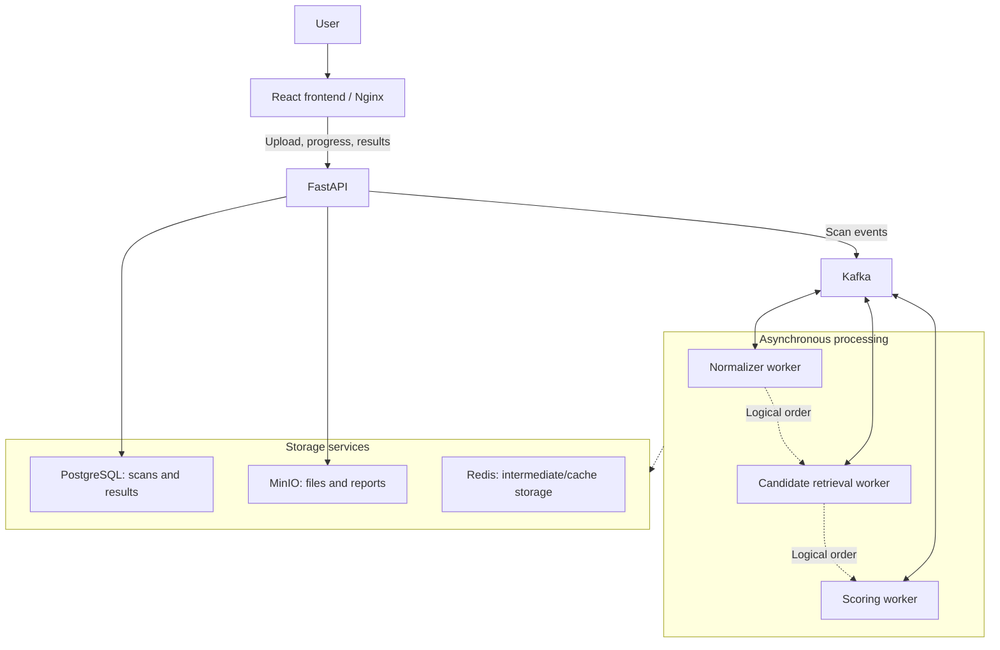

# PlagCode — Code Similarity Analysis

PlagCode is a Dockerized web application for comparing source files using token-based analysis and the Jaccard index. It combines a React interface, a FastAPI backend, and an event-driven processing architecture with Kafka and dedicated workers.

The project demonstrates software and data engineering applied to code similarity. The current analysis is lexical; machine learning and semantic comparison are planned improvements.

> A similarity score is an indicator for human review, not proof of plagiarism or a probability that plagiarism occurred.

## Features

- Upload multiple files and start a comparison scan.
- Track scan status and progress through the application/API.
- Compare token overlap and return pairwise similarity scores and labels.
- Review results through tables, heatmaps, relationship graphs, and a side-by-side comparison interface.
- Process scans asynchronously using Kafka and dedicated workers.
- Persist scan metadata and results in PostgreSQL, and uploaded files and JSON reports in MinIO.
- Run the application and its dependencies with Docker Compose.

File acceptance does not guarantee language-aware parsing. Notebook uploads have been accepted in a local scan, but extraction of code cells and exclusion of notebook metadata still need verification.

## Architecture



The API accepts uploads and starts a scan. Kafka coordinates asynchronous
processing across normalization, candidate retrieval, and scoring workers.
The frontend queries the API to display progress and results.

Dashed arrows show the logical processing order and grouped storage access;
worker stages communicate through Kafka. This overview reflects the intended
architecture in the Compose configuration. Exact event routing and per-worker
storage access remain to be verified against the implementation.

| Service | Responsibility |
| --- | --- |
| `web` | Nginx serves the frontend and proxies API requests. |
| `api` | FastAPI receives uploads and exposes scan operations. |
| `normalizer-worker` | Handles the normalization stage. |
| `candidate-retrieval-worker` | Handles candidate-pair selection. |
| `scoring-worker` | Computes similarity scores. |
| `kafka` | Transports processing events between components. |
| `zookeeper` | Supports the current Kafka deployment. |
| `postgres` | Stores scan metadata, status, and results. |
| `redis` | Provides fast intermediate/cache storage. |
| `minio` | Stores uploaded objects and reports. |
| `kafka-init` | Creates the required Kafka topics. |
| `minio-init` | Ensures the upload bucket exists. |

Configured Kafka topics: `code.submitted`, `code.normalized`, `code.candidates`, `code.scored`, and `code.deadletter`.

Services communicate over the `plagcode-net` Docker network. Named volumes preserve PostgreSQL and MinIO data independently of container replacement.

## Project Layout

Key paths used by the current Docker configuration:

```text
backend/                  # FastAPI application and workers
  app/                    # app.main and app.workers modules
  db/migrations/          # PostgreSQL initialization scripts
frontend/                 # React frontend
nginx/Dockerfile          # Web image build
docker-compose.yml        # Services, networking, and volumes
.env.example              # Configuration template
```

## Requirements

- Docker Desktop installed and running, with Linux containers enabled.
- Docker Compose v2 (`docker compose`).
- Internet access for the initial image downloads and builds.

## Quick Start

Run commands from the directory containing `docker-compose.yml`.

### 1. Configure the environment

On Windows PowerShell:

```powershell
Copy-Item .env.example .env
```

On Linux/macOS:

```bash
cp .env.example .env
```

Run this copy only when creating your configuration; do not overwrite an existing customized `.env`.

Check the database, Kafka, Redis, and MinIO settings. Container-to-container connections use service names, for example `kafka:9092`, `redis:6379`, and `minio:9000`.

Keep `.env` and real credentials out of version control. The current Compose configuration explicitly sets local PostgreSQL credentials; changing `.env` alone does not override those entries. Database initialization scripts run when the PostgreSQL data directory is first initialized.

### 2. Build and start

```bash
docker compose up -d --build
```

### 3. Check service status

```bash
docker compose ps -a
```

- Long-running services should be `Up`.
- PostgreSQL and Redis should be `Up (healthy)`.
- `kafka-init` and `minio-init` should finish with `Exited (0)`.
- A running process does not by itself verify successful end-to-end processing.

### 4. Open the application

| Endpoint | Local address |
| --- | --- |
| Frontend | http://localhost:8082 |
| API documentation | http://localhost:8001/docs |
| MinIO S3 API | http://localhost:19000 |
| PostgreSQL | `localhost:5432` |

These addresses assume the updated MinIO mapping `127.0.0.1:19000:9000`. The MinIO console listens on port `9001` inside its container but is not published by the current configuration.

## Usage

1. Open the frontend and upload at least two files.
2. Start a scan and follow its progress.
3. Wait for completion before interpreting results.
4. Review pairwise scores and visualizations, then inspect the source files.

### Submit a scan through the API

PowerShell example using the curl executable:

```powershell
curl.exe -X POST "http://localhost:8001/api/scan" -F "files=@samples/a.py" -F "files=@samples/b.py"
```

Replace the example paths with files that exist on your computer.

Example response:

```json
{
  "scanId": "ceabb136-96fe-402c-bc15-fd4647def224",
  "message": "Scan started"
}
```

This acknowledges submission, not completion. Use the status and results operations documented in `/docs` with the returned scan identifier.

## Similarity Method

The current baseline compares sets of tokens using the Jaccard index:

```text
J(A, B) = |A intersection B| / |A union B|
```

Here, A and B are token sets extracted from the two inputs. The API presents similarity on a percentage scale.

This method is deterministic for a fixed preprocessing implementation and input. It measures lexical overlap; it does not establish semantic equivalence, authorship, or intent.

## Current Limitations

- Token sets do not preserve token order or frequency.
- Results depend on tokenization and normalization; identifier renaming and shared boilerplate can affect scores.
- The current score thresholds and labels require benchmark-based validation.
- A low score does not prove that two programs are unrelated.
- A local result returned an empty `overlap_spans` list. Precise matching-line localization and highlighting are not yet validated.
- A local result reported `runtime_ms: 0`; timing instrumentation needs verification before using that value for performance claims.
- Notebook-specific extraction and language coverage require targeted tests.
- Successful container startup and a completed scan do not independently prove that every infrastructure service was used as intended; integration tests remain necessary.
- The supplied configuration is intended for local development. Review authentication, upload limits, secrets, and exposure before public deployment.

## Useful Commands

```bash
# Start existing services
docker compose up -d

# Rebuild after application/image changes
docker compose up -d --build

# Include stopped and initialization containers
docker compose ps -a

# Follow processing logs
docker compose logs -f --tail=100 api normalizer-worker candidate-retrieval-worker scoring-worker

# Inspect initialization logs
docker compose logs --tail=50 kafka-init minio-init

# Observe resource usage
docker stats

# Stop without removing containers
docker compose stop

# Stop and remove project containers and networks; keep named volumes
docker compose down
```

`Ctrl+C` exits log streaming without stopping services. Avoid `docker compose down -v` unless you intend to delete the project volumes and their stored data.

## Troubleshooting

### Port 9000 is unavailable

Publish MinIO on a different host port:

```yaml
ports:
  - "127.0.0.1:19000:9000"
```

Keep internal connections on `minio:9000`, then apply the change with `docker compose up -d`.

### MinIO initialization never finishes

```bash
docker compose logs --tail=80 minio-init minio
```

The updated initialization service uses `pgsty/mc:RELEASE.2026-11-09T00-00-00Z`, with a shell entrypoint and bounded connection retries. It replaces the previous startup download that produced an invalid client file containing an HTTP `410` response.

Successful initialization ends with `MinIO bucket ensured.` and exit code `0`.

### API or workers remain in Created state

Check dependent services and initialization jobs with `docker compose ps -a`, then inspect their logs. Fix the failed dependency and rerun `docker compose up -d`.

## Planned Improvements

The following items are roadmap goals, not current capabilities:

- Reproducible evaluation datasets, precision/recall/F1, and validated thresholds.
- Comparison of lexical, structural, and embedding-based approaches.
- Matching-segment extraction and source highlighting.
- Measured processing duration and scalability benchmarks.
- Integration tests covering storage and event processing.
- Optional ML models and LLM explanations, evaluated before adoption.

## Responsible Use

Use PlagCode to identify similarities for investigation and discussion. Shared templates, common algorithms, and short files can produce misleading scores. Human review and contextual evidence are required before drawing conclusions about plagiarism.
