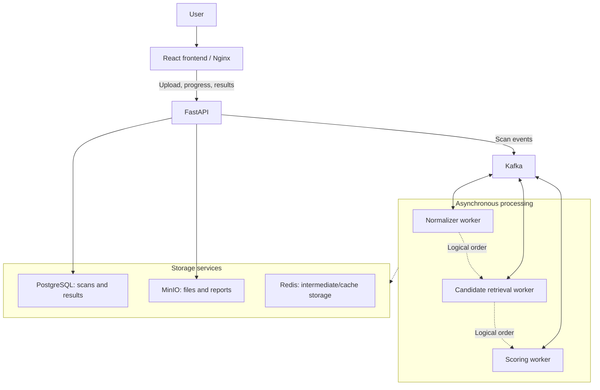

# PlagCode — Code Similarity Analysis

PlagCode is a Dockerized web application for comparing source files using token-based analysis and the Jaccard index. It combines a React interface, a FastAPI backend, and an event-driven processing architecture with Kafka and dedicated workers.

PlagCode explores code similarity through lexical analysis with Jaccard. Planned extensions include structural and semantic comparison with reproducible evaluation.

> A similarity score is an indicator for human review, not proof of plagiarism or a probability that plagiarism occurred.

## Contents

- [Features](#features)
- [Architecture](#architecture)
- [Project Layout](#project-layout)
- [Requirements](#requirements)
- [Quick Start](#quick-start)
- [Usage and API](#usage-and-api)
- [Similarity Method](#similarity-method)
- [Evaluation and Validation](#evaluation-and-validation)
- [Current Limitations](#current-limitations)
- [Useful Commands](#useful-commands)
- [Troubleshooting](#troubleshooting)
- [Planned Improvements](#planned-improvements)
- [Responsible Use](#responsible-use)

## Features

- Upload multiple files and start a comparison scan.
- Track scan status and progress through the application/API.
- Compare token overlap and return pairwise similarity scores and labels.
- Review results through tables, heatmaps, relationship graphs, and a side-by-side comparison interface.
- Process scans asynchronously using Kafka and dedicated workers.
- Persist scan metadata and results in PostgreSQL, and uploaded files and JSON reports in MinIO.
- Run the application and its dependencies with Docker Compose.

## Architecture



The API accepts uploads and starts a scan. Kafka coordinates asynchronous
processing across normalization, candidate retrieval, and scoring workers.
The frontend queries the API to display progress and results.

Dashed arrows show the logical processing order and grouped storage access;
worker stages communicate through Kafka. The diagram is a conceptual overview
of the Compose services, rather than an exhaustive map of runtime connections.

| Service | Responsibility |
| --- | --- |
| `web` | Nginx serves the frontend and proxies API requests. |
| `api` | FastAPI receives uploads and exposes scan operations. |
| `normalizer-worker` | Handles the normalization stage. |
| `candidate-retrieval-worker` | Handles candidate-pair selection. |
| `scoring-worker` | Computes similarity scores. |
| `kafka` | Transports processing events between components. |
| `zookeeper` | Supports the current Kafka deployment. |
| `postgres` | Stores scan metadata, status, and results. |
| `redis` | Provides fast intermediate/cache storage. |
| `minio` | Stores uploaded objects and reports. |
| `kafka-init` | Creates the required Kafka topics. |
| `minio-init` | Ensures the upload bucket exists. |

Configured Kafka topics: `code.submitted`, `code.normalized`, `code.candidates`, `code.scored`, and `code.deadletter`.

Services communicate over the `plagcode-net` Docker network. Named volumes preserve PostgreSQL and MinIO data independently of container replacement.

## Project Layout

Key paths used by the current Docker configuration:

```text
backend/                  # FastAPI application and workers
  app/                    # app.main and app.workers modules
  db/migrations/          # PostgreSQL initialization scripts
frontend/                 # React frontend
nginx/Dockerfile          # Web image build
docker-compose.yml        # Services, networking, and volumes
.env.example              # Configuration template
```

## Requirements

- Docker Desktop installed and running, with Linux containers enabled.
- Docker Compose v2 (`docker compose`).
- Internet access for the initial image downloads and builds.

## Quick Start

Run commands from the directory containing `docker-compose.yml`.

### 1. Configure the environment

On Windows PowerShell:

```powershell
Copy-Item .env.example .env
```

On Linux/macOS:

```bash
cp .env.example .env
```

Run this copy only when creating your configuration; do not overwrite an existing customized `.env`.

Check the database, Kafka, Redis, and MinIO settings. Container-to-container connections use service names, for example `kafka:9092`, `redis:6379`, and `minio:9000`.

Keep `.env` and real credentials out of version control. The current Compose configuration explicitly sets local PostgreSQL credentials; changing `.env` alone does not override those entries. Database initialization scripts run when the PostgreSQL data directory is first initialized.

### 2. Build and start

```bash
docker compose up -d --build
```

### 3. Check service status

```bash
docker compose ps -a
```

- Long-running services should be `Up`.
- PostgreSQL and Redis should be `Up (healthy)`.
- `kafka-init` and `minio-init` should finish with `Exited (0)`.

### 4. Open the application

| Endpoint | Local address |
| --- | --- |
| Frontend | http://localhost:8082 |
| API documentation | http://localhost:8001/docs |
| MinIO S3 API | http://localhost:19000 |
| PostgreSQL | `localhost:5432` |

These addresses assume the updated MinIO mapping `127.0.0.1:19000:9000`. The MinIO console listens on port `9001` inside its container but is not published by the current configuration.

## Usage and API

1. Open the frontend and upload at least two files.
2. Start a scan and follow its progress.
3. Wait for completion before interpreting results.
4. Review pairwise scores and visualizations, then inspect the source files.

### API entry points

| Method | Path | Purpose |
| --- | --- | --- |
| `POST` | `/api/scan` | Submit files as multipart form data and receive a scan identifier. |
| `GET` | `/docs` | Open the interactive API reference, including status and results operations. |

### Submit a scan through the API

PowerShell example using the curl executable:

```powershell
curl.exe -X POST "http://localhost:8001/api/scan" -F "files=@samples/a.py" -F "files=@samples/b.py"
```

Replace the example paths with files that exist on your computer.

Example response:

```json
{
  "scanId": "ceabb136-96fe-402c-bc15-fd4647def224",
  "message": "Scan started"
}
```

This acknowledges submission, not completion. Use the status and results operations documented in `/docs` with the returned scan identifier.

## Similarity Method

The current baseline compares sets of tokens using the Jaccard index:

```text
J(A, B) = |A intersection B| / |A union B|
```

Here, A and B are token sets extracted from the two inputs. The API presents similarity on a percentage scale.

For example, consider these simplified token sets:

- A = `{read, parse, compare, report}`
- B = `{read, parse, compare, save}`
- Intersection: 3 tokens; union: 5 tokens.
- Jaccard similarity: `3 / 5 × 100 = 60%`.

This is an illustrative set calculation, not an output from the tokenizer.
The method is deterministic for fixed inputs and preprocessing. It measures
lexical overlap rather than semantic equivalence or authorship.

## Evaluation and Validation

### Current local checks

- PostgreSQL and Redis passed their configured health checks.
- Kafka and MinIO initialization jobs completed with exit code `0`.
- A two-file notebook submission returned a scan identifier, reached `DONE`, and produced one pairwise result.

These are manual smoke checks. Automated test results and benchmark metrics
are not reported in this README.

### Planned evaluation

The first evaluation milestone is a reproducible comparison against labeled
pairs, including exact copies, formatting changes, identifier renaming, and
unrelated examples. Source files and their transformed variants will stay in
the same split to avoid leakage between training, validation, and test data.

The report will include precision, recall, F1, threshold selection on validation
data, and results on a held-out test set. No accuracy claims are made before
this evaluation is completed.

## Current Limitations

- **Lexical scope:** token sets discard order and frequency. Renaming and shared boilerplate can affect scores.
- **Thresholds:** similarity categories are heuristic; benchmark calibration is planned.
- **Matching segments:** the observed result contained `overlap_spans: []`; precise line highlighting is not demonstrated.
- **Timing:** the observed result contained `runtime_ms: 0`; performance measurements are not reported.
- **Notebooks:** upload and scan completion were observed. Code-cell-only extraction is not established by that test.
- **Deployment:** the supplied configuration targets local development. Public deployment requires a review of authentication, credentials, and upload controls.

## Useful Commands

```bash
# Start existing services
docker compose up -d

# Rebuild after application/image changes
docker compose up -d --build

# Include stopped and initialization containers
docker compose ps -a

# Follow processing logs
docker compose logs -f --tail=100 api normalizer-worker candidate-retrieval-worker scoring-worker

# Inspect initialization logs
docker compose logs --tail=50 kafka-init minio-init

# Observe resource usage
docker stats

# Stop without removing containers
docker compose stop

# Stop and remove project containers and networks; keep named volumes
docker compose down
```

`Ctrl+C` exits log streaming without stopping services. Avoid `docker compose down -v` unless you intend to delete the project volumes and their stored data.

## Troubleshooting

### Port 9000 is unavailable

Publish MinIO on a different host port:

```yaml
ports:
  - "127.0.0.1:19000:9000"
```

Keep internal connections on `minio:9000`, then apply the change with `docker compose up -d`.

### MinIO initialization never finishes

```bash
docker compose logs --tail=80 minio-init minio
```

The updated initialization service uses `pgsty/mc:RELEASE.2026-11-09T00-00-00Z`, with a shell entrypoint and bounded connection retries.

Successful initialization ends with `MinIO bucket ensured.` and exit code `0`.

### API or workers remain in Created state

Check dependent services and initialization jobs with `docker compose ps -a`, then inspect their logs. Fix the failed dependency and rerun `docker compose up -d`.

## Planned Improvements

The following items are roadmap goals, not current capabilities:

- Reproducible evaluation datasets, precision/recall/F1, and validated thresholds.
- Comparison of lexical, structural, and embedding-based approaches.
- Matching-segment extraction and source highlighting.
- Measured processing duration and scalability benchmarks.
- Integration tests covering storage and event processing.
- Optional ML models and LLM explanations, evaluated before adoption.

## Responsible Use

Use PlagCode to identify similarities for investigation and discussion. Shared templates, common algorithms, and short files can produce misleading scores. Human review and contextual evidence are required before drawing conclusions about plagiarism.
